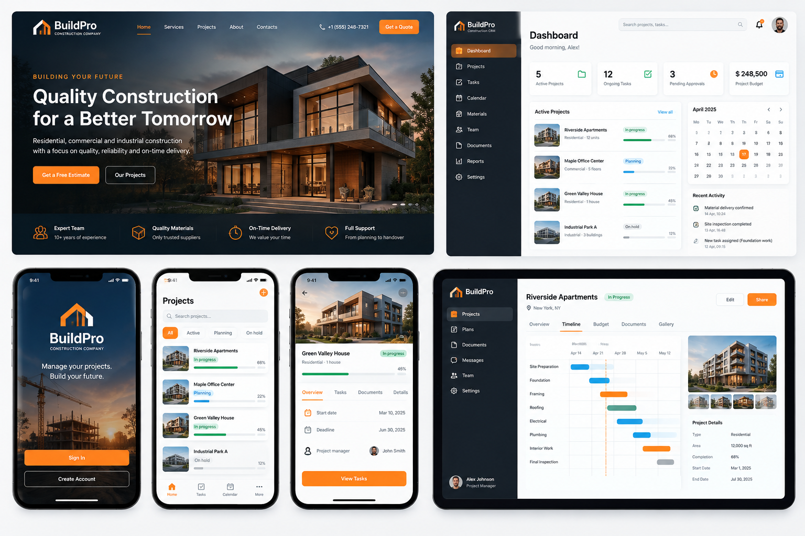
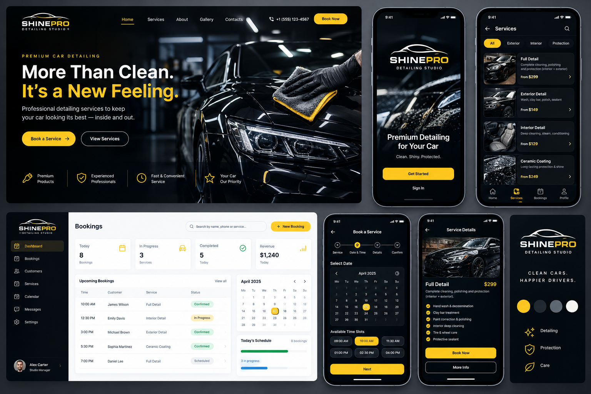
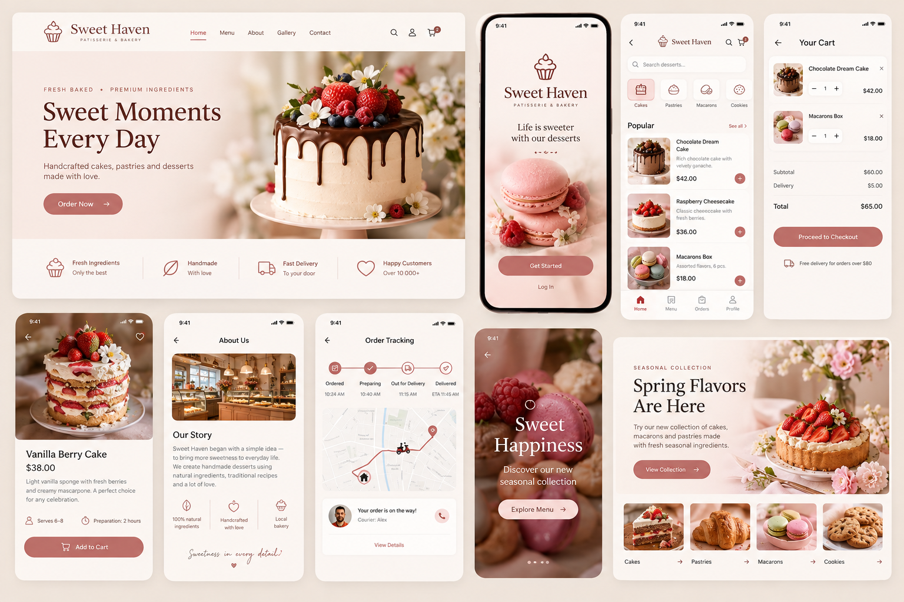

# UI Design Collection

**Portfolio concept · PANTIK / Pavel Kashyn**

A collection of interface concepts for construction, car detailing and a pastry shop. Each presentation combines website layouts, mobile screens and dashboard views tailored to its industry.

## Gallery

## About

Presented as a design concept for portfolio purposes. Brand names, sample contact details and promotional offers shown in the visuals are part of the concepts.

This repository contains image exports. Editable design source files are not included.

[Portfolio](https://pantikdesign.pages.dev/) · [Behance](https://www.behance.net/paveldesigns) · [Contact](https://t.me/pk_designstudio)
